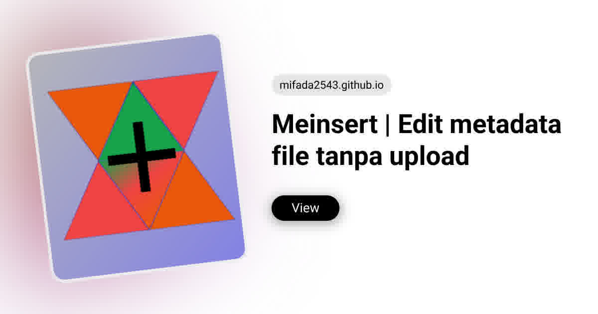

<div align="center">


# MeInsert

**Edit metadata without uploading — entirely in your browser.**

Read and write image, PDF, audio, video, and Office document metadata directly on your device.<br />
No backend. No uploads. No account.

[Bahasa Indonesia](README.md) · **English**

[Live demo](https://meinsert.my.id/) · [Single-file editor](https://meinsert.my.id/single.html) · [Batch mode](https://meinsert.my.id/batch.html) · [Documentation](#further-documentation)

[](https://github.com/mifada2543/meinsert/actions/workflows/ci.yml)
[](./package.json)
[](./LICENSE)
[](#how-to-verify-the-local-only-claim)
[](https://meinsert.my.id/)



</div>

## Quick start

Every mode runs in your browser, with no account.

| Need | Open | Notes |
|---|---|---|
| Edit **one file**'s metadata | [Single-file editor](https://meinsert.my.id/single.html) | Format-specific fields, custom tags, and a raw tag table. |
| Edit **many files** at once | [Batch mode](https://meinsert.my.id/batch.html) | Output is a ZIP plus JSON/CSV reports. |
| **Clean metadata** from files | [Clean metadata](https://meinsert.my.id/index.html?clean=1) | Remove sensitive GPS/EXIF data or pick tags per category. |

Running a local copy? See [Quick installation](#quick-installation-xampp). Local pages: [`single.html`](./single.html) · [`batch.html`](./batch.html) · [`index.html?clean=1`](./index.html?clean=1).

## Contents

- [Why MeInsert?](#why-meinsert)
- [Supported formats](#supported-formats)
- [How to use](#how-to-use)
- [Key features](#key-features)
- [Limitations](#limitations)
- [Interface language](#interface-language)
- [Quick installation (XAMPP)](#quick-installation-xampp)
- [How to verify the local-only claim](#how-to-verify-the-local-only-claim)
- [Further documentation](#further-documentation)
- [Development](#development)
- [License](#license)
- [Usage and privacy policies](#usage-and-privacy-policies)

## Why MeInsert?

- **Local processing.** Files are read and written in the browser using WebAssembly and Web Workers. No file is uploaded to any server.
- **Lightweight deployment.** Static files: no backend and no deployment build step. Runs directly on XAMPP/Apache.
- **Offline support.** The app shell works offline after caching completes; format engines and WASM work offline after they have been loaded once.

One principle, three needs: edit a single file, process many files by format group, or clean metadata. In **clean metadata** mode you can choose the Privacy profile, remove everything safe, or pick categories yourself. Results are still reviewed and verified as usual.

Technology: JavaScript ES2022 (no framework), WebAssembly, Web Workers, and a Service Worker.

## Supported formats

Formats are detected from the **file contents**, not just the extension, so a wrongly named file is still read correctly. Only the relevant fields are shown.

| Category | Formats | Writing method |
|---|---|---|
| Images | JPEG, PNG, WebP, TIFF | XMP + EXIF; IPTC for JPEG/TIFF |
| Images | HEIC, HEIF | XMP (*best-effort*); placeholder preview |
| RAW images | DNG, CR2, CR3, NEF, ARW, ORF, RW2, RAF | XMP-only (*best-effort*); placeholder preview |
| RAW video | BRAW, R3D, ARRIRAW | **Read-only** — cannot be saved; placeholder preview |
| PDF | PDF | Info Dictionary + XMP stream |
| Audio | MP3, FLAC, OGG Vorbis / Opus | ID3v2.3, Vorbis Comment; stream-copy remuxing |
| Video | MP4 / M4A / MOV, MKV / WebM | ItemList + XMP through ExifTool; Matroska SimpleTag with stream-copy remuxing |
| Office | DOCX, XLSX, PPTX, ODT, ODS, ODP | Patches only the metadata XML parts; all other ZIP entries are verified byte-for-byte |

Technical details and per-format limits are in the [limitations documentation](docs/LIMITATIONS.md).

### GPS & metadata IPTC/XMP

Image metadata fields include **GPS** — latitude, longitude, altitude, and date —
now placed in its own **GPS metadata** tab, plus the **IPTC/XMP DAM** fields: Credit, Source, CaptionWriter, JobTitle,
CopyrightOwner, Rating, Label, Identifier, and Location. The fields appear for
image formats that support XMP; values are written to the XMP packet and verified
by reading the output back, like any other field. Only changed fields are written,
so other unsupported tags are not guaranteed to survive.

### Format HEIC, RAW, dan RAW video

- **HEIC / HEIF** — only XMP tags are requested on a *best-effort* basis.
  The engine may still rewrite container structures. The preview uses a placeholder because browsers do not render the format natively.
- **RAW images** (DNG, CR2, CR3, NEF, ARW, ORF, RW2, RAF) — **XMP-only**
  (*best-effort*) with a placeholder preview. Only XMP tags are requested;
  the engine may still repack RAW containers, so full sensor/maker-note byte
  preservation is not guaranteed without real-format verification.
- **RAW video** (BRAW, R3D, ARRIRAW) — **read-only**: metadata can be read, but
  the file cannot be saved; the save guard rejects writes. The preview is also a
  placeholder.

Invalid GPS coordinates are rejected; negative altitude is stored with a
*Below Sea Level* reference. TIFF-based RAW inferred from filename alone is
marked with an explicit uncertainty warning.

CinemaDNG inside MOV/MKV containers keeps using the `mp4`/`mkv` adapters, not the
RAW adapter. Every flow still runs on your device and works offline once cached;
nothing is uploaded. Details are in the
[limitations documentation](docs/LIMITATIONS.md).

### Cover art / thumbnails

JPEG/PNG/WebP covers up to 10 MB are embedded natively per format. GIF/BMP covers are also supported for MP3, FLAC, OGG/Opus, and MKV. Covers can be replaced or removed.

| Format | Native structure |
|---|---|
| MP3 | `APIC` |
| FLAC, OGG, Opus | `METADATA_BLOCK_PICTURE` |
| MP4 / M4A | `covr` (JPEG/PNG/WebP only) |
| MKV / WebM | Matroska attachment |

### Synchronized lyrics & subtitles

The **Lyrics & subtitles** button opens a two-column editor: media preview on the left and the line list on the right (video uses a landscape layout). The preview uses your local media (`blob:`) with no upload.

- **Editing:** type text, timestamp each line directly, import (`.lrc`, `.srt`, `.vtt`), and export timed text.
- **Text appearance (video subtitles only):** the **gear** button opens a card for text colour, background colour/opacity, size, bold, shadow, position, and alignment, including a **MEeL** preset. LRC cannot store colours or backgrounds, so the button is not offered for lyrics.
- **Card behaviour:** while the card is open the **+ Line** / gear ✕ / **Show: Subtitle** toolbar stays visible, the controls are arranged as compact rows, the editor is covered by a dark overlay (no blur), and the primary button becomes **Save preference** (stored in `localStorage`); when closed it returns to **Apply**. Click outside the card or press the gear ✕ to close; unsaved changes prompt **Discard** / **Save**.
- **Drafts:** lines are saved automatically and cleared after **Apply**.
- **Writing to the file:** the text is embedded inside the container, not into the video pixels. Lyrics can also become a track labelled "Lirik". The original file is never overwritten.

| Format | Where it is stored |
|---|---|
| MP3 | `SYLT` |
| FLAC, OGG, Opus | `LYRICS` comment |
| MP4 / M4A | `©lyr` + WebVTT track |
| MKV / WebM | WebVTT track |

The `STYLE` block and cue settings are written too. Colours and backgrounds are guaranteed in the preview and the `.vtt` file; internal players may differ. Details are in the [limitations documentation](docs/LIMITATIONS.md).

### Cut audio/video

The **Cut audio/video** button appears in the action-bar options for MP3, FLAC, OGG/Opus, MP4/M4A, MOV, MKV, and WebM. The dialog shows a local preview, `mm:ss.mmm` inputs, buttons to mark the start/end from the playhead, and two modes:

- **Copy** (default): stream-copy without transcoding when keyframes allow it.
- **Precise**: exact boundaries; may transcode locally.

The range is staged as a `trim` change in the editor and joins undo/redo; it is processed only when you press **Save**. The output is verified against a media range proof before download, and the original file is never overwritten. An offline guard blocks the button when the related engine package has not been cached.

### Change history

The **History** button in the editor head, next to **Undo** / **Redo**, opens a list of every action in the current session: field edits, custom tags, cover, raw tags, metadata cleaning, lyrics/subtitles, cuts, and the output name. Each entry shows a human-readable label and time.

Choosing **Roll back to this version** asks for confirmation first. After a rollback you can still press **Undo** (Ctrl+Z) to cancel that rollback. History is not persisted across reloads or file changes.

### Office documents

- **Fully supported:** DOCX, XLSX, PPTX, as well as ODT, ODS, ODP.
- **Best-effort:** macro-enabled variants `.docm`, `.xlsm`, `.pptm`. Macros are preserved byte-for-byte, but verify the output after saving.
- **Signatures:** editing metadata in a signed Office document invalidates its signature.
- **Unsupported:** encrypted Office files and legacy `.doc`, `.xls`, `.ppt` formats.
- Every write patches only the metadata XML parts and verifies all other ZIP entries byte-for-byte.

## How to use

### 1. Choose a file

Open the home page and select **Single file** for individual editing or **Batch** for multiple files.

### 2. Edit metadata

Fields appear according to the format. Change the fields you need, add **custom tags**, replace cover art, or clear fields to remove tags.

### 3. Save and download

Select **Save**, review the changes, and confirm. The output is read again and verified before you download a new file (or a ZIP for batch). The original file is never overwritten.

> [!NOTE]
> **Change tracking:** only requested field changes are submitted for writing. This does not guarantee preservation of every unsupported tag. The output extension follows detected content by default; the mismatch review dialog also offers an explicit option to keep the original extension. Renaming a file does not convert its format.

## Key features

### Single file vs batch

| | Single file | Batch |
|---|---|---|
| Limits | Up to 4 GB per file | Up to 10 video files, 20 audio files, or 50 images/PDFs |
| Editing | Format-specific fields, custom tags, searchable raw table | Format groups or shared cross-format fields, file selection, per-file raw tags |
| Output | Verified file with controlled naming | ZIP + JSON/CSV reports |

### Safe workflow

- **Review before writing** — inspect changed fields, custom tags, raw tags, and covers; no-op changes are omitted.
- **Automatic verification** — output is read again and metadata outside the change plan is compared before and after.
- **Custom and raw tags** — add non-standard metadata per format and search raw tags quickly.
- **Undo/redo** — available in the single-file editor and, separately, per format group in batch mode.
- **Office document preview** — a summary card built from document metadata (title, creator, counts, signature/macro status) helps you confirm you picked the right file. A bounded content excerpt is available when present; it is not a full-fidelity rendering.

### User experience

- **Light/dark theme** — follows the system or a manual preference, with no flash on load.
- **Continuous media preview** — changing a thumbnail or discarding changes does not stop audio/video preview.
- **Animated preview** — smooth open/close that keeps media playing and respects the system's reduced-motion setting.
- **Comfortable on small screens** — theme, language, and settings move into the ☰ menu (which turns into ✕ when open); primary actions stay visible, secondary controls live in the **Options** panel.
- **About page** — a short summary of principles, supported formats, and policy links on one page ([`about.html`](about.html)).
- **One-time policy notice** — just click **Got it**; the choice is saved in your browser for 30 days.

### Offline and storage

- **Installable PWA** — install from the browser menu; the app shell and format dependencies work offline after first load.
- **Storage & Offline settings** — choose *Frugal* (default), *Mostly ready*, or *Download everything*. Frugal mode is forced automatically when the browser enables Save-Data.

## Limitations

MeInsert rewrites metadata locally and verifies the result, but some data cannot be preserved. The integrity report shown after a write is the authoritative per-file result.

- **Size and memory:** up to 4 GB per file; the estimated peak memory raises a warning. When it reaches the block band, writing can continue only via low-memory mode (batch) or explicit risk acknowledgement (single file); quick-save cannot bypass it.
- **Change scope:** only the fields you change are written. This is not a promise that every unsupported tag survives.
- **Digital signatures:** editing a signed PDF or Office document invalidates its signature.
- **Specific formats:** MKV/WebM chapters and attachments are generally not carried over; FLAC-in-Ogg and Speex are unsupported; encrypted PDFs are unsupported and encrypted Office files are rejected.
- **Players:** some players do not show Ogg/Opus cover art or embedded subtitle colours.

Full per-format details: [docs/LIMITATIONS.md](docs/LIMITATIONS.md).

## Interface language

Select **ID** (Indonesian) or **EN** (English) in the header of the home, single-file, or batch page. On small screens (≤700px), the toggle lives in the ☰ menu together with the theme button and **Storage & Offline**.

- The preference is stored locally under `meinsert-language`.
- Without a saved preference, the Indonesian/English browser language is used; other languages fall back to Indonesian.
- Switching language does not reload the page or change files, metadata values, or JSON/CSV report schemas.
- Documentation: **[Indonesian](README.md)** · **[English](README-en.md)**.

## Quick installation (XAMPP)

No deployment build is needed. HTML/CSS/JS and vendor files are included in the repository.

```bash
# 1. Put a copy in your XAMPP htdocs folder, then open it in the browser
git clone https://github.com/mifada2543/meinsert.git MeInsert
# http://localhost/MeInsert/
```

You do **not** need `npm install` to use the app. `npm install` and `npm run vendor` are only for **development** or when upgrading libraries (see [CONTRIBUTING.md](CONTRIBUTING.md)).

Use your browser's **Install / Add to Home Screen** action to install the PWA.

> [!NOTE]
> Stay online until the browser finishes caching the pages and main assets. Then the pages can open offline. Vendor libraries and ExifTool WASM (~27 MB) are fetched and cached on first use. In **Storage & Offline** you can choose Frugal, Mostly ready, or Download everything.

Run a local server without XAMPP:

```bash
npm run serve  # http://localhost:8000
```

Hosting note: `.htaccess` is for Apache/XAMPP, `_headers` is for Netlify/Cloudflare Pages, and GitHub Pages ignores both. See the [deployment guide](docs/deployment.md).

## How to verify the local-only claim

1. Open DevTools → **Network**.
2. Open a file, edit its metadata, then save.
3. There should be **no requests to any other address**; everything happens in your browser.
4. After the first visit, switch on airplane mode: the pages and editor still work.

The Content Security Policy blocks outgoing requests too, so this check is more than a promise.

Full guide plus a note about the production host's analytics beacon: [docs/security.md](docs/security.md). Automated check: `node tests/e2e/security.mjs`.

## Further documentation

Technical depth is kept out of this README to keep it short.

| Document | Contents |
|---|---|
| [Documentation map](docs/README.md) | Start here: every document, its audience, and language. |
| [Troubleshooting](docs/TROUBLESHOOTING.md) | Common symptoms, causes, and safe actions. |
| [Testing guide](docs/TESTING.md) | Test layers, commands, and environment variables. |
| [Release checklist](docs/RELEASING.md) | Version and cache sync for maintainers. |
| [Architecture and project layout](docs/ARCHITECTURE.md) | Workflow, modules, workers, and WASM. |
| [Limitations and compatibility findings](docs/LIMITATIONS.md) | Per-format limits, verification, and harness evidence. |
| [Verifying the local-only claim](docs/security.md) | DevTools, airplane mode, and CSP. |
| [Deployment and hosting headers](docs/deployment.md) | `.htaccess`, `_headers`, GitHub Pages, and `/sw.js` caching. |
| [About page](about.html) | A quick explanation for new users. |
| [Launch notes](docs/launch-notes.md) | Release summary. |
| [Contributing guide](CONTRIBUTING.md) | Project rules, npm scripts, and how to add a format. |
| [Changelog](CHANGELOG.md) | Change history. |

## Development

Prerequisite: Node.js 22. Install development dependencies with `npm ci`. Full contribution rules are in [CONTRIBUTING.md](CONTRIBUTING.md).

### Main commands

| Command | Purpose |
|---|---|
| `npm run serve` | Local server at `http://localhost:8000`. |
| `npm run test:fast` | Fast gate, no browser: unit + lint + CSS + policy checks. |
| `npm test` | Unit tests. |
| `npm run lint` | ESLint. |
| `npm run check:css` | Verify the CSS bundle matches its sources. |
| `npm run check:policies` | Verify the policy pages match their Markdown sources. |
| `npm run build:css` | Regenerate `app.bundle.css`. |
| `npm run build:policies` | Regenerate the policy pages from Markdown. |
| `npm run test:e2e` | Browser smoke test (one suite). |
| `npm run test:e2e:all` | All E2E suites in one shared Chrome process (CDP). |
| `npm run test:compat` | Compatibility cases with real fixtures. |

CI shards the E2E suites across 4 runners: `MEINSERT_E2E_SHARD=1/4 npm run test:e2e:all`.

### Per-feature E2E suites

| Command | Coverage |
|---|---|
| `npm run test:preview` | Preview open/close animation. |
| `npm run test:action-bar` | Action bar and Options panel. |
| `npm run test:about` | About page and mobile menu. |
| `npm run test:offline` | Storage & Offline settings. |
| `npm run test:reveal` | Scroll-reveal animation. |
| `npm run test:i18n` | Bilingual UI and offline. |
| `npm run test:undo` · `npm run test:undo:batch` | Single-file and batch undo/redo. |
| `npm run test:security` | CSP and network audit. |
| `npm run test:engine` | WASM engine download and status. |
| `npm run test:wasm-integrity` | WASM E2E with an active Service Worker. |
| `npm run test:timed-text` | Lyrics/subtitle editor and appearance preferences. |
| `npm run test:quick-save` | Quick save. |
| `npm run test:clean` | Clean metadata (single file and batch). |
| `npm run test:office` | OOXML/ODF documents. |

## License

**Application code:** [MeInsert Source-Available License v1.0](./LICENSE) — Copyright (C) 2026 mifada2543.

**Source:** [github.com/mifada2543/meinsert](https://github.com/mifada2543/meinsert). Every page also links to Source in its footer.

**Notices:** [NOTICE.md](./NOTICE.md) (Indonesian) · [NOTICE-en.md](./NOTICE-en.md) (English).

### Third-party attribution

Bundled dependencies retain their own licenses. See the [attribution index](assets/THIRD_PARTY_LICENSES.md).

- **ExifTool 13.60** (Artistic/GPL), **@colorhythm/exiftool-wasm** (Apache-2.0) + **zeroperl** (MIT)
- **Mediabunny** (MPL-2.0), **pdf-lib**, **browser-id3-writer**, **fflate** (MIT)
- **IBM Plex fonts** — SIL Open Font License 1.1
- **MEeL — LRC editor & timed-text helpers** (MeInsert Source-Available License v1.0, © 2026 Mifada) — adapted from MEeL-HUB for the lyrics/subtitle editor; original MEeL releases remain AGPL-3.0. The exact source and destination files are listed in [NOTICE-en.md](./NOTICE-en.md) and the [attribution index](assets/THIRD_PARTY_LICENSES.md).
- **Brand artwork** — original project assets; see [provenance](assets/img/PROVENANCE.md).

### Licensing and monetization

This is not an *open source* license: the Original Version may be used and self-hosted internally without a user limit, while a **Modified Version for internal use is limited to three people**. Public Hosting is allowed without a user limit when it is free of charge, ad-free, and meets the NOTICE obligations. **Monetizing hosting, access, or distribution requires separate written permission** from the Rights Holder; paid work done with MeInsert remains allowed. Earlier releases stay under their original license (section 7 of [LICENSE](./LICENSE)). The LICENSE text is binding; the full plain-language summary is in [NOTICE.md](./NOTICE.md) / [NOTICE-en.md](./NOTICE-en.md).

### Responsible use

MeInsert only provides a *tool* for reading and writing standard tags. You are responsible for files you edit: do not remove or forge copyright attribution, and comply with local law.

## Usage and privacy policies

| Document | Page | Source |
|---|---|---|
| Acceptable Use | [ID/EN page](Terms.html) | [Indonesian](TERMS.md) · [English](TERMS-en.md) |
| Privacy Policy | [ID/EN page](privacy.html) | [Indonesian](PRIVACY.md) · [English](PRIVACY-en.md) |
| Security | [SECURITY.md](SECURITY.md) | [security.txt](.well-known/security.txt) |

**The official application does not send or upload file contents, edited metadata, cover art, or processing outputs to a server.** See [docs/security.md](docs/security.md) for how to verify this claim, including a note about the analytics beacon injected by the production host.

**Forgery for deception or unlawful purposes is prohibited.** Established violations may result in penalties under applicable law and lawful proceedings; MeInsert does not automatically impose punishment. The use policy does not add restrictions to the MeInsert Source-Available License v1.0.

---

<div align="center">

**MeInsert** — Built for files that should stay private.

No backend · No uploads · Entirely on your device

[Back to top](#meinsert)

</div>
