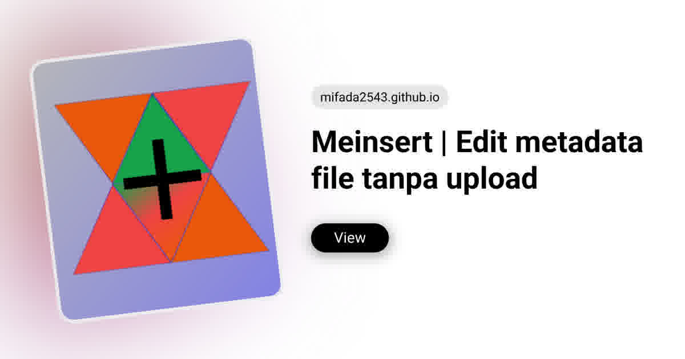

<div align="center">


# MeInsert

**🇮🇩 Indonesia** · [🇬🇧 English](README-en.md)

**Edit metadata tanpa upload — 100% di browser**

Baca & tulis metadata gambar, PDF, audio, dan video langsung di perangkat Anda.
Tidak ada server. Tidak ada upload. Tidak ada akun.

[](https://meinsert.my.id/)
[](https://meinsert.my.id/)
[](https://meinsert.my.id/)
[](https://github.com/mifada2543/meinsert/actions/workflows/ci.yml)

[](./package.json)
[](./LICENSE)
[]()
[]()




</div>

## Cara pakai 30 detik

Pilih salah satu dari tiga kebutuhan ini — semuanya berjalan di browser Anda, tanpa akun:

| Kebutuhan | Buka | Status |
|---|---|---|
| ✏️ Edit metadata **satu file** | [Editor Satu file](https://meinsert.my.id/single.html) | Tersedia |
| 📦 Edit **banyak file** sekaligus + ZIP & laporan | [Mode Batch](https://meinsert.my.id/batch.html) | Tersedia |
| 🧹 **Bersihkan metadata** dari berkas | [Bersihkan metadata](https://meinsert.my.id/index.html?clean=1) | Tersedia — hapus GPS/EXIF sensitif atau pilih tag per kategori |

[🚀 Coba demo langsung](https://meinsert.my.id/) · [📄 Satu file](./single.html) · [📦 Batch](./batch.html) · [🧹 Bersihkan metadata](./index.html?clean=1) · [⚙️ Instalasi](#instalasi-cepat-xampp)

---

## Daftar isi

- [Kenapa MeInsert?](#kenapa-meinsert)
- [Format didukung](#format-didukung)
- [Cara pakai](#cara-pakai)
- [Fitur unggulan](#fitur-unggulan)
- [Bahasa antarmuka](#bahasa-antarmuka)
- [Instalasi cepat (XAMPP)](#instalasi-cepat-xampp)
- [Cara memverifikasi klaim lokal](#cara-memverifikasi-klaim-lokal)
- [Dokumentasi lanjutan](#dokumentasi-lanjutan)
- [Development](#development)
- [Lisensi](#lisensi)
- [Kebijakan penggunaan dan privasi](#kebijakan-penggunaan-dan-privasi)

---

## Kenapa MeInsert?

| 🔒 Privasi Absolut | ⚡ Cepat & Ringan | 📴 Offline-First |
|---|---|---|
| Semua dibaca/ditulis di browser via WASM + Workers. Tidak ada upload ke server mana pun. | Statis — tanpa backend dan tanpa build saat deploy. Jalan langsung dari XAMPP/Apache. | App shell tersedia offline setelah pemasangan cache selesai. Engine format dan WASM tersedia offline setelah sekali dimuat. |

**Tiga kebutuhan, satu prinsip:** edit satu file, proses massal per grup format, atau bersihkan metadata. Mode **bersihkan metadata** sudah tersedia — pilih profil Privasi, hapus semua yang aman, atau atur sendiri per kategori. Hasilnya tetap ditinjau dan diverifikasi seperti biasa.

---

## Format didukung

Format dikenali dari **isi file**, bukan hanya ekstensi — jadi file yang salah nama tetap terbaca dengan benar. Hanya field yang relevan yang ditampilkan. Detail teknis penulisan ada di [dokumentasi keterbatasan](docs/LIMITATIONS.md).

| Kategori | Format | Metode Penulisan |
|---|---|---|
| 🖼️ **Gambar** | JPEG, PNG, WebP, TIFF | XMP + EXIF, IPTC untuk JPEG/TIFF |
| 📄 **PDF** | PDF | Info Dictionary + XMP stream |
| 🎵 **Audio** | MP3, FLAC, OGG Vorbis / Opus | ID3v2.3, Vorbis Comment (remux lossless) |
| 🎬 **Video** | MP4 / M4A / MOV, MKV / WebM | ItemList + XMP (ExifTool), Matroska SimpleTag (remux lossless) |
| 📑 **Office** | DOCX, XLSX, PPTX, ODT, ODS, ODP | Hanya menambal bagian XML metadata; semua entri ZIP lain diverifikasi byte-for-byte |

### Sampul / thumbnail

Embed cover image (JPEG/PNG/WebP ≤ 10 MB; GIF/BMP juga untuk MP3, FLAC, OGG/Opus, dan MKV) secara native per format — `APIC` untuk MP3, `METADATA_BLOCK_PICTURE` untuk FLAC/OGG/Opus, `covr` untuk MP4/M4A (JPEG/PNG/WebP saja), Matroska attachment untuk MKV/WebM. Bisa diganti/dihapus. Rincian dan batasnya ada di [dokumentasi keterbatasan](docs/LIMITATIONS.md).

### Lirik & subtitle tersinkron

Tombol **Lirik & Subtitle** di editor membuka editor dua kolom: pratinjau media di kiri dan daftar baris di kanan (mode video memakai tata lanskap). Anda bisa mengetik, menandai waktu langsung di tiap baris, mengimpor (`.lrc`, `.srt`, `.vtt`), dan mengekspor teks berirama. Pratinjau memakai media lokal Anda (`blob:`), tanpa upload.

Tombol **gear** membuka panel **Tampilan teks** untuk mengatur warna teks, warna/opacity latar, ukuran, tebal, bayang, posisi, dan perataan — dengan preset **MEeL**. Preferensi tersimpan di `localStorage` setelah ditekan **Simpan preferensi**; perubahan yang belum disimpan memunculkan pilihan **Batalkan** / **Simpan**. Draf baris juga tersimpan otomatis dan dihapus setelah Anda menekan **Terapkan**.

Saat menyimpan, teks disisipkan ke dalam kontainer: `SYLT` untuk MP3, komentar `LYRICS` untuk FLAC/OGG/Opus, `©lyr` + track WebVTT untuk MP4/M4A, dan track WebVTT untuk MKV/WebM. Lirik juga bisa menjadi track berlabel "Lirik". Blok `STYLE` dan cue settings ikut ditulis; warna/latar dijamin pada pratinjau dan file `.vtt`, sedangkan pemutar internal mungkin berbeda. File asli tidak pernah ditimpa. Detail dan batasnya ada di [dokumentasi keterbatasan](docs/LIMITATIONS.md).

### Dokumen Office

- **Didukung penuh:** DOCX, XLSX, PPTX, serta ODT, ODS, ODP.
- **Best-effort:** varian makro `.docm`, `.xlsm`, `.pptm`. Makro dipertahankan apa adanya (byte-identik), tetapi periksa hasilnya setelah disimpan.
- **Tanda tangan:** mengubah metadata pada dokumen Office bertanda tangan akan membuat tanda tangannya tidak valid.
- **Tidak didukung:** Office terenkripsi dan format lama `.doc`, `.xls`, `.ppt`.
- Setiap penulisan Office hanya menambal bagian XML metadata dan memverifikasi semua entri ZIP lainnya byte-for-byte.

---

## Cara pakai

### 1. Pilih File

Buka beranda → pilih **Satu file** untuk edit satuan atau **Banyak file** untuk batch.

### 2. Edit Metadata

Field muncul dinamis sesuai format. Ubah yang Anda butuhkan, tambah **tag kustom**, ganti sampul, atau kosongkan field untuk menghapus tag.

### 3. Simpan & Unduh

Klik **Simpan** → tinjau seluruh perubahan → konfirmasi → hasil dibaca ulang & diverifikasi otomatis → unduh file baru (atau ZIP untuk batch). File asli tidak pernah ditimpa.

> **Pelacakan perubahan:** hanya perubahan field yang diminta yang dikirim untuk ditulis. Ini bukan jaminan seluruh tag yang tidak didukung tetap utuh. Ekstensi hasil secara default mengikuti isi terdeteksi; dialog mismatch juga menawarkan pilihan mempertahankan ekstensi asli. Mengganti nama bukan konversi format.

---

## Fitur unggulan

### Satu file vs batch

| | Satu File | Batch (Massal) |
|---|---|---|
| Batas | Maks. 4 GB per file | Video maks. 10 file, Audio maks. 20, Gambar/PDF maks. 50 |
| Edit | Field dinamis, custom tags, raw table + search | Per grup format atau field standar lintas format, pilih file yang diproses, raw tag per file |
| Hasil | Satu file terverifikasi + rename aman | ZIP + laporan JSON/CSV |

### Lainnya

- **Review sebelum tulis** — dialog menampilkan seluruh field, tag kustom, raw tag, dan sampul yang berubah; perubahan yang tidak mengubah nilai otomatis dilewati.
- **Verifikasi otomatis** — output dibaca ulang, lalu metadata di luar rencana dibandingkan sebelum vs sesudah.
- **Tag kustom & raw tag** — tambah metadata non-standar per format dan cari tag mentah dengan cepat.
- **Undo/redo** — tersedia di editor satu file dan, terpisah, per grup format pada batch.
- **Tema gelap/terang** — ikut sistem, bisa manual, tanpa flicker saat memuat.
- **PWA Installable** — pasang ke layar utama; app shell dan dependensi format tersedia offline setelah dimuat sekali.
- **Pratinjau media kontinu** — mengganti thumbnail atau membatalkan perubahan tidak menghentikan pratinjau audio/video.
- **Halaman Tentang** — ringkasan prinsip, format yang didukung, dan tautan kebijakan; cukup satu halaman tanpa harus membaca dokumen panjang.
- **Pemberitahuan kebijakan sekali konfirmasi** — cukup klik **Mengerti**; pilihan Anda disimpan di browser selama 30 hari.
- **Penyimpanan & Offline** — pilih *Hemat* (default), *Siap sebagian*, atau *Unduh semuanya*. MeInsert otomatis memakai mode hemat jika browser mengaktifkan Save-Data.
- **Nyaman di layar kecil** — tombol tema, bahasa, dan pengaturan masuk ke menu ☰ (berubah menjadi ✕ saat terbuka); tombol aksi utama tetap terlihat, pengaturan lain ada di panel **Opsi**.
- **Buka/tutup pratinjau beranimasi** — halus, tidak menghentikan putar media, dan hormati pengaturan pengurangan gerak di sistem.
- **Pratinjau dokumen Office** — kartu ringkasan dari metadata dokumen (judul, pembuat, jumlah, status tanda tangan/makro) membantu memastikan Anda memilih file yang benar. Cuplikan isi terbatas bisa dibuka bila tersedia; ini bukan tampilan isi halaman penuh.

---

## Bahasa antarmuka

Pilih **ID** (Indonesia) atau **EN** (English) di header beranda, editor satu file, maupun batch. Di layar kecil (≤700px), tombolnya ada di dalam menu ☰ bersama tombol tema dan **Penyimpanan & Offline**.

- Pilihan disimpan secara lokal dengan kunci `meinsert-language`.
- Tanpa preferensi, bahasa browser Indonesia/Inggris dipakai; bahasa lain memakai Indonesia sebagai fallback.
- Pergantian bahasa tidak memuat ulang halaman dan tidak mengubah file, nilai metadata, atau skema laporan JSON/CSV.
- Dokumentasi: **[Indonesia](README.md)** · **[English](README-en.md)**.

---

## Instalasi cepat (XAMPP)

Tidak perlu build. File HTML/CSS/JS statis, vendor sudah termasuk di repo.

```bash
# 1. Letakkan salinan di folder htdocs/XAMPP Anda, lalu buka di browser
git clone https://github.com/mifada2543/meinsert.git MeInsert
# http://localhost/MeInsert/
```

Tidak perlu menjalankan `npm install` untuk memakai aplikasi — library vendor sudah termasuk di repository. `npm install` dan `npm run vendor` hanya diperlukan jika Anda **mengembangkan** atau memperbarui library (lihat CONTRIBUTING.md).

Gunakan menu browser **Install / Tambahkan ke layar utama** untuk memasang PWA.

> Kunjungan pertama tetap online sampai browser selesai menyimpan halaman dan aset utamanya. Setelah itu halaman bisa dibuka offline. Library vendor dan ExifTool WASM (~27 MB) diambil saat pertama dipakai lalu disimpan. Di pengaturan **Penyimpanan & Offline** Anda bisa memilih mode Hemat, Siap sebagian, atau Unduh semuanya.

Serve lokal tanpa XAMPP:

```bash
npm run serve  # http://localhost:8000
```

Catatan hosting: `.htaccess` untuk Apache/XAMPP, `_headers` untuk Netlify/Cloudflare Pages, dan GitHub Pages mengabaikan keduanya — lihat [panduan deployment](docs/deployment.md).

---

## Cara memverifikasi klaim lokal

Buka DevTools → **Network**, lalu buka file → ubah → simpan. Seharusnya **tidak ada permintaan ke alamat lain** — semua proses terjadi di browser Anda. Setelah kunjungan pertama, aktifkan mode pesawat: halaman dan editor tetap bisa dipakai. Aturan keamanan (`Content-Security-Policy`) juga memblokir permintaan keluar, jadi pemeriksaan ini bukan sekadar janji.

Panduan lengkap + penjelasan beacon analitik host produksi: **[docs/security.md](docs/security.md)**. Pemeriksaan otomatis: `node tests/e2e/security.mjs`.

---

## Dokumentasi lanjutan

Detail teknis dipindahkan dari README agar halaman ini tetap ringkas:

- **[Arsitektur & struktur proyek](docs/ARCHITECTURE.md)** — alur kerja, modul, worker, dan WASM.
- **[Keterbatasan & temuan kompatibilitas](docs/LIMITATIONS.md)** — batas per format, verifikasi, dan bukti harness.
- **[Verifikasi klaim lokal](docs/security.md)** — DevTools, mode pesawat, dan CSP.
- **[Deployment & header hosting](docs/deployment.md)** — `.htaccess`, `_headers`, GitHub Pages, dan cache `/sw.js`.
- **[Halaman Tentang](about.html)** — penjelasan singkat untuk pengguna baru.
- **[Catatan peluncuran](docs/launch-notes.md)** — ringkasan rilis.

---

## Development

```bash
npm run serve            # server lokal http://localhost:8000
npm run test:fast        # gate cepat: unit + lint + CSS + policy (~3det, tanpa browser)
npm test                 # 372 unit test
npm run lint             # ESLint
npm run check:css        # pastikan bundel CSS sinkron dengan sumber
npm run check:policies   # pastikan halaman kebijakan sinkron dengan Markdown
npm run test:e2e         # smoke test browser (1 suite)
npm run test:e2e:all     # semua 18 suite E2E dalam satu proses Chrome (CDP)
# CI membagi suite ke 4 runner: MEINSERT_E2E_SHARD=1/4 npm run test:e2e:all
npm run test:preview     # animasi buka/tutup pratinjau
npm run test:action-bar  # action bar & panel Opsi
npm run test:about       # halaman Tentang & menu mobile
npm run test:offline     # pengaturan Penyimpanan & Offline
npm run test:reveal      # animasi muncul saat scroll
npm run test:i18n        # UI bilingual & offline
npm run test:undo        # undo/redo satu file
npm run test:undo:batch  # undo/redo batch
npm run test:security    # CSP + audit jaringan
npm run test:engine      # unduh & status engine WASM
npm run test:wasm-integrity # E2E WASM dengan Service Worker aktif
npm run test:timed-text  # editor lirik/subtitle + preferensi tampilan
npm run test:quick-save  # simpan cepat
npm run test:clean       # bersihkan metadata (satu file & batch)
npm run test:office      # dokumen Office OOXML/ODF
npm run test:compat      # 48 kasus kompatibilitas dengan fixture nyata
npm run build:css        # regenerasi app.bundle.css
npm run build:policies   # regenerasi halaman kebijakan dari Markdown
```

---

## Lisensi

**Kode aplikasi:** [AGPLv3](./LICENSE) — Copyright (C) 2026 mifada2543

**Source:** [https://github.com/mifada2543/meinsert](https://github.com/mifada2543/meinsert) · tautan **Source** juga ada di footer setiap halaman (kewajiban transparansi AGPL §13).

**Pemberitahuan:** [NOTICE.md](./NOTICE.md) (Indonesia) · [NOTICE-en.md](./NOTICE-en.md) (English).

### Atribusi pihak ketiga

Library pihak ketiga yang dibundel tetap pada lisensi aslinya — lihat [indeks atribusi](assets/THIRD_PARTY_LICENSES.md):

- **ExifTool 13.60** (Artistic/GPL), **@colorhythm/exiftool-wasm** (Apache-2.0) + **zeroperl** (MIT)
- **Mediabunny** (MPL-2.0), **pdf-lib**, **browser-id3-writer**, **fflate** (MIT)
- **Font IBM Plex** — SIL Open Font License 1.1
- **MEeL — editor LRC & helper teks berirama** (AGPL-3.0, © 2026 Mifada) — kode yang diadaptasi untuk editor lirik/subtitle; daftar file sumber dan tujuan ada di [NOTICE.md](./NOTICE.md) dan [indeks atribusi](assets/THIRD_PARTY_LICENSES.md).
- **Gambar merek** — karya asli proyek; [provenance](assets/img/PROVENANCE.md)

### Lisensi & monetisasi (AGPLv3)

Monetisasi boleh, tetapi AGPLv3 bersifat *copyleft jaringan*: saat mendistribusikan perangkat lunak tercakup, sediakan **Corresponding Source**. Modifikasi privat tidak otomatis wajib dipublikasikan. Teks [LICENSE](./LICENSE) yang mengikat; ringkasan ini hanya penjelasan sederhana.

### Catatan penggunaan yang pantas

MeInsert hanya menyediakan *alat* untuk membaca/menulis tag standar. Anda bertanggung jawab atas file milik Anda: jangan menghapus atau memalsukan atribusi hak cipta, dan patuhi hukum setempat.

---

## Kebijakan penggunaan dan privasi

- **Kebijakan Penggunaan:** [Halaman ID/EN](Terms.html) · sumber [Indonesia](TERMS.md) / [English](TERMS-en.md).
- **Kebijakan Privasi:** [Halaman ID/EN](privacy.html) · sumber [Indonesia](PRIVACY.md) / [English](PRIVACY-en.md).
- **Keamanan:** [SECURITY.md](SECURITY.md) · [security.txt](.well-known/security.txt).

**Isi berkas, metadata yang diedit, sampul, dan hasil pemrosesan tidak dikirim
atau diunggah ke server oleh aplikasi resmi.** Baca [docs/security.md](docs/security.md) untuk cara memverifikasi klaim tersebut, termasuk catatan tentang beacon analitik yang disuntikkan host produksi.

**Pemalsuan untuk menipu atau melakukan pelanggaran hukum dilarang.** Pelanggaran yang terbukti dapat dikenai sanksi sesuai hukum dan proses pihak berwenang; MeInsert tidak menjatuhkan hukuman otomatis. Kebijakan penggunaan tidak menambahkan pembatasan pada lisensi AGPL.

---

<div align="center">

**MeInsert** — Dibuat untuk file yang ingin tetap privat.

_Tidak ada backend · Tidak ada upload · 100% di perangkat Anda_

[⬆ Kembali ke atas](#meinsert)

</div>
