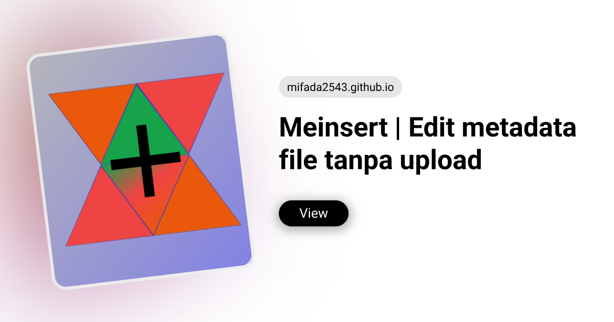

<div align="center">


# MeInsert

**Edit metadata tanpa upload — 100% di browser**

Baca & tulis metadata gambar, PDF, audio, dan video langsung di perangkat Anda.
Tidak ada server. Tidak ada upload. Tidak ada akun.

[](https://mifada2543.github.io/MeInsert/)
[](https://mifada2543.github.io/MeInsert/)
[](https://mifada2543.github.io/MeInsert/)

[](./package.json)
[](./LICENSE)
[]()
[]()


<br/>

[🚀 Coba Demo Langsung](https://mifada2543.github.io/MeInsert/) ·
[📄 Edit Satu File](./single.html) ·
[📦 Proses Massal / Batch](./batch.html) ·
[⚙️ Instalasi](#instalasi-cepat-xampp)



</div>

> **MeInsert** adalah editor metadata lokal berbasis web. Semua pemrosesan berjalan di sisi klien dengan WebAssembly + Web Workers — file Anda tidak pernah meninggalkan perangkat, bahkan bisa dipakai offline setelah kunjungan pertama.

---

## Daftar Isi

- [Kenapa MeInsert?](#kenapa-meinsert)
- [Format Didukung](#format-didukung)
- [Cara Pakai (30 Detik)](#cara-pakai-30-detik)
- [Fitur Unggulan](#fitur-unggulan)
- [Instalasi Cepat (XAMPP)](#instalasi-cepat-xampp)
- [Teknologi](#teknologi)
- [Keterbatasan v1](#keterbatasan-v1)
- [Development](#development)
- [Lisensi](#lisensi)

---

## Kenapa MeInsert?

| 🔒 Privasi Absolut | ⚡ Cepat & Ringan | 📴 Offline-First |
|---|---|---|
| Semua dibaca/ditulis di browser via WASM + Workers. Tidak ada upload ke server mana pun. | Statis — tanpa backend, tanpa build step. Jalan langsung dari XAMPP/Apache. | PWA terinstal, cache lengkap termasuk WASM. Setelah kunjungan pertama, jalan offline. |

**Dua mode, satu prinsip:**
- **Satu file** — editor satuan dengan field dinamis mengikuti format file
- **Banyak file (Batch)** — periksa, edit per grup format atau pakai field standar lintas format, unduh ZIP + laporan JSON/CSV

---

## Format Didukung

Deteksi otomatis dari **magic bytes** (bukan hanya ekstensi), lalu hanya field yang relevan untuk format tersebut yang ditampilkan.

| Kategori | Format | Metode Penulisan |
|---|---|---|
| 🖼️ **Gambar** | JPEG, PNG, WebP, TIFF | XMP + EXIF, IPTC untuk JPEG/TIFF |
| 📄 **PDF** | PDF | Info Dictionary + XMP stream, struktur tetap utuh |
| 🎵 **Audio** | MP3, FLAC, OGG Vorbis / Opus | ID3v2.3, Vorbis Comment (remux lossless) |
| 🎬 **Video** | MP4 / M4A / MOV, MKV / WebM | ItemList + XMP (ExifTool), Matroska SimpleTag (remux lossless) |

### Sampul / Thumbnail
Embed cover image (JPEG/PNG/WebP ≤ 10 MB; GIF/BMP juga untuk MP3, FLAC, OGG/Opus, dan MKV) secara native per format — `APIC` untuk MP3, `METADATA_BLOCK_PICTURE` untuk FLAC/OGG/Opus, `covr` untuk MP4/M4A (JPEG/PNG/WebP saja), Matroska attachment untuk MKV/WebM. Bisa diganti/dihapus.

---

## Cara Pakai (30 Detik)

### 1. Pilih File
Buka beranda → pilih **Satu file** untuk edit satuan atau **Banyak file** untuk batch.

### 2. Edit Metadata
Field muncul dinamis sesuai format. Ubah yang Anda butuhkan, tambah **tag kustom**, ganti sampul, atau kosongkan field untuk menghapus tag.

### 3. Simpan & Unduh
Klik **Simpan** → hasil dibaca ulang & diverifikasi otomatis → unduh file baru (atau ZIP untuk batch). File asli tidak pernah ditimpa.

> **Aman by design:** hanya field yang berubah yang ditulis (dirty tracking). Nama file hasil bebas diganti, tapi ekstensi terkunci mengikuti format terdeteksi — tidak bisa `.mp3` → `.flac` hanya lewat rename.

---

## Fitur Unggulan

### Satu File vs Batch — Kapan Pakai Yang Mana?

| | Satu File | Batch (Massal) |
|---|---|---|
| Batas | Maks. 4 GB per file | Video maks. 10 file, Audio maks. 20, Gambar/PDF maks. 50 |
| Edit | Field dinamis, custom tags, raw table + search | Per grup format atau field standar lintas format, pilih file yang diproses, raw tag per file |
| Hasil | Satu file terverifikasi + rename aman | ZIP + laporan JSON/CSV |

### Lainnya
- **Verifikasi otomatis** — output dibaca ulang sebelum unduh
- **Tag kustom** — tambah metadata non-standar per format (nama native per engine)
- **Global search raw tag** — lihat semua tag mentah + cari cepat
- **Perbesar pratinjau** — klik gambar (pratinjau utama, cover audio, pratinjau cover, pratinjau batch) untuk lightbox layar penuh; klik lagi / scroll untuk zoom, geser untuk menggeser, Esc untuk tutup
- **Tema gelap/terang** — ikut sistem, bisa manual, transisi circular reveal, tanpa flicker (tema diterapkan sebelum paint pertama)
- **PWA Installable** — pasang ke layar utama dari menu browser; precache app shell + library vendor (~2 MB), ExifTool WASM di-cache saat pertama dipakai
- **Manajemen memori WASM** — worker & ExifTool WASM dilepas otomatis setelah batch, saat idle (~8 menit), dan saat halaman ditutup

---

## Instalasi Cepat (XAMPP)

Tidak perlu build. File HTML/CSS/JS statis, vendor sudah termasuk di repo.

```bash
# 1. Clone ke htdocs
cd /opt/lampp/htdocs
git clone <repo> MeInsert
cd MeInsert

# 2. (Sekali saja / saat update library) Pasang vendor
npm install
npm run vendor

# 3. Buka di browser
# http://localhost/MeInsert/
# → gunakan menu Install / Tambahkan ke layar utama untuk PWA
```

> Kunjungan pertama tetap online agar service worker bisa mengunduh cache offline (~2 MB). Setelah itu, semua halaman (`/`, `/single.html`, `/batch.html`) bekerja offline. ExifTool WASM (~27 MB) tidak ikut di-precache; format yang memakainya menjadi offline setelah sekali pemakaian.

**Catatan:** `assets/vendor/` sudah dibundel di repo — `npm run vendor` hanya diperlukan saat update versi library.

Serve lokal tanpa XAMPP:
```bash
npm run serve  # http://localhost:8000
```

---

## Teknologi

| Lapisan | Teknologi |
|---|---|
| **App** | Vanilla JS (ES2022), HTML5, CSS3 (responsive + dark mode) |
| **PWA** | Manifest + Service Worker (precache app shell + vendor; WASM on-demand) |
| **Engine Gambar/MP4** | ExifTool WASM (~27 MB, lazy-load via Worker) |
| **Engine Media** | Mediabunny — remux lossless MP3/FLAC/OGG/MKV |
| **Engine PDF** | pdf-lib — Info Dict + XMP stream |
| **ID3** | browser-id3-writer |
| **ZIP Batch** | fflate (streaming di memori browser) |
| **Worker** | Satu worker per engine + RPC, dispose/idle timeout |

<details>
<summary><strong>Arsitektur & struktur proyek (klik untuk detail)</strong></summary>

### Alur kerja

1. **PWA** → `sw.js` precache app shell + library vendor; ExifTool WASM di-cache on-demand → offline setelah kunjungan pertama
2. **Deteksi** → `detector.js` baca 128 byte pertama → format & subtype
3. **Adapter** → `registry.js` pilih adapter per format
4. **Worker** → `worker-client.js` spawn worker per engine, dengan dispose/idle timeout
5. **Read** → adapter `read(file)` → normalisasi field standar + raw tags
6. **UI** → `form-view.js` render field dinamis, custom tags, raw tab
7. **Write** → `collectChanges()` → `adapter.write(file, payload)`
8. **Verify** → baca ulang output → bandingkan perubahan
9. **Download** → Blob → `<a download>` / ZIP untuk batch

**Routing statis:** `/` (pemilih mode), `/single.html`, `/batch.html` — semua ter-precache, bekerja offline.

### Struktur proyek

```
MeInsert/
├── index.html                 # Beranda: pilih Satu file / Banyak file
├── single.html                # Editor satu file
├── batch.html                 # Batch: periksa & proses banyak file
├── manifest.json              # PWA manifest
├── sw.js                      # Service worker (precache app shell + vendor, WASM on-demand)
├── .htaccess                  # MIME types & cache headers
├── package.json               # Dev deps & vendor script
├── scripts/vendor.mjs         # Copy node_modules → assets/vendor/
├── tests/
│   ├── e2e/smoke.mjs          # Smoke test browser/PWA/batch
│   └── unit/                  # Unit test batch, XMP PDF, format lintas grup, cover
└── assets/
    ├── css/app.css            # Styling (responsive, dark mode)
    ├── js/
    │   ├── home.js            # Entry beranda (theme + registrasi SW saja)
    │   ├── app.js             # App shell editor satu file & batch; registrasi SW
    │   ├── core/              # detector, registry (adapter lazy), tag-utils, format-map, image-utils, errors, pwa, worker-client
    │   ├── batch/             # batch-limits, batch-processor, batch-view, batch-report, batch-zip
    │   ├── engines/exiftool.js
    │   ├── formats/           # image, pdf, mp3, flac, ogg, vorbis-common, mkv, mp4
    │   ├── ui/                # dom, icons, toast, theme, file-card, form-view, raw-view, result-view
    │   └── workers/           # rpc, exiftool.worker, media.worker, pdf.worker
    └── vendor/                # Bundled libraries (tanpa build)
```

### Catatan teknis

- **ExifTool WASM** di-lazy-load via worker dan tidak di-precache; pertama kali ~1-2 detik, lalu tersimpan di cache service worker
- **Loading**: beranda memakai `home.js` (kecil); adapter format dan UI batch di-`import()` hanya saat dibutuhkan
- **PDF:** hanya properti XMP yang diubah yang ditulis ulang; Deskripsi dan properti asing (xmpMM, photoshop, namespace kustom) dipertahankan. Jika paket XMP tidak bisa diparse dengan aman, XMP ditulis ulang dan pengguna diberi peringatan
- **MP3:** tag ID3 lama dihapus saat rewrite; hanya tag TXXX yang diketahui yang dipertahankan
- **FLAC/OGG/MKV:** Mediabunny remux lossless (`copy: {mode:'forced'}`) — stream hash identik
- **OGG/Opus:** membutuhkan `copy.shiftTolerance: Infinity` karena paket Ogg pertama ber-timestamp negatif (pre-roll)
- **MP4 cover:** dibaca via pass tambahan Mediabunny (ExifTool WASM tidak bisa kembalikan byte binary murni)
- **Custom tags:** native ExifTool names untuk Gambar/MP4, Info dict keys untuk PDF, TXXX untuk MP3, Vorbis/Matroska keys (uppercase) untuk FLAC/OGG/MKV
- **WASM memory:** satu worker per engine, `dispose`/terminate setelah batch, `pagehide`, idle timeout ~8 menit

</details>

---

## Keterbatasan v1

- **MP3:** frame ID3 non-standar (selain yang dipetakan) hilang saat menulis
- **MKV:** chapter & attachment tidak dipertahankan saat remux
- **PDF:** PDF terenkripsi tidak didukung; PDF bertanda tangan digital → tanda tangan invalid; XMP yang rusak/aneh akan ditulis ulang (dengan peringatan), sehingga properti asing bisa hilang pada kasus itu
- **PNG/WebP:** field kamera ditulis sebagai XMP (`XMP-tiff:Make/Model`, `XMP-aux:Lens`, `XMP-exif:DateTimeOriginal`), bukan EXIF biner; aplikasi yang hanya membaca EXIF mungkin tidak menampilkannya
- **Batch:** ZIP di browser tanpa mengunduh ulang seluruh arsip bila didukung (`showSavePicker` di Chrome/Edge — streaming langsung ke disk); fallback ke memori di browser lain — video maks. 10 file (≤1 jam, total ≤2 GB), audio maks. 20 (≤30 menit, ≤1 GB), gambar/PDF maks. 50 (≤1 GB); file dengan durasi tak terbaca dikunci
- **Batch:** field standar (judul, artis, album, tanggal, genre, komentar, hak cipta, komposer, perangkat lunak) bisa diterapkan lintas grup; field yang tidak tersedia di suatu format otomatis dilewati. Custom tags tetap per grup
- **OGG:** hanya Vorbis & Opus (FLAC-in-Ogg/Speex ditolak); tidak semua pemutar tampilkan cover Ogg/Opus
- **Cover:** JPEG/PNG/WebP ≤10 MB untuk semua format; GIF/BMP ≤10 MB hanya untuk MP3/FLAC/OGG/MKV (MP4 `covr` menolak GIF/BMP). Tidak semua pemutar menampilkan cover Ogg/Opus

---

## Development

```bash
# Serve lokal
npm run serve            # http://localhost:8000

# Unit test (batch, XMP PDF, pemetaan lintas format, cover, PNG round-trip)
npm test

# Smoke test browser (butuh Chrome/Chromium, override CHROME_BIN bila perlu)
npm run test:e2e

# Update vendor libraries
npm install && npm run vendor

# Lint (opsional)
npx eslint assets/js --ext .js
```

---

## Lisensi

**Kode aplikasi:** [AGPLv3](./LICENSE) — Copyright (C) 2026 mifada2543

**Source:** [https://github.com/mifada2543/meinsert](https://github.com/mifada2543/meinsert) · tautan **Source** juga ada di footer setiap halaman (kewajiban transparansi AGPL §13).

### Atribusi pihak ketiga

Library pihak ketiga yang dibundel tetap pada lisensi aslinya — lihat [assets/THIRD_PARTY_LICENSES.md](./assets/THIRD_PARTY_LICENSES.md):

- **ExifTool 13.60** oleh Phil Harvey — Perl Artistic License atau GPL (teks hak cipta di `assets/vendor/licenses/exiftool-LICENSE.txt`)
- **@colorhythm/exiftool-wasm v1.0.5** — Apache-2.0, plus **zeroperl** (MIT) sebagai runtime WASM-nya
- **Mediabunny** — MPL-2.0 · **pdf-lib**, **browser-id3-writer**, **fflate** — MIT (+ dependensi tersembunyi pdf-lib: pako MIT AND Zlib, standard-fonts/upng MIT, tslib 0BSD)
- **Font IBM Plex** — SIL Open Font License 1.1 (`assets/fonts/OFL.txt`)
- **Gambar merek** — karya asli proyek ini; provenance di [assets/img/PROVENANCE.md](./assets/img/PROVENANCE.md)

Nama ExifTool, Mediabunny, pdf-lib, IBM Plex, dan zeroperl adalah merek dagang pemiliknya; penyebutan di sini hanya untuk identifikasi asal kode, bukan dukungan resmi.

### Lisensi & Monetisasi (AGPLv3)

MeInsert **boleh dimonetisasi** (produk berbayar, hosting berbayar, layanan premium). Syaratnya, AGPLv3 bersifat *copyleft jaringan*:

- Anda boleh mengenakan biaya untuk distribusi, dukungan, atau layanan.
- Jika Anda **mengubah** MeInsert dan menyebarkannya **atau** menjalankannya sebagai layanan jaringan (termasuk situs publik, SaaS, atau aplikasi yang berinteraksi dengan pengguna dari jarak jauh), Anda **wajib** menawarkan **Corresponding Source dari versi Anda** kepada semua penerima/pengguna secara gratis, melalui mekanisme standar (repo publik / tautan Source), selama versi itu berjalan.
- Anda **tidak boleh** menutup kode modifikasi MeInsert di balik layanan proprietary.
- Kontribusi pihak ketiga di atas tetap tunduk pada lisensinya masing-masing; AGPL tidak mengubahnya.

Ringkasnya: **monetisasi boleh, menutup kode tidak boleh.** Teks [LICENSE](./LICENSE) yang mengikat; ringkasan ini hanya penjelasan bahasa sederhana.

### Catatan penggunaan yang pantas

MeInsert hanya menyediakan *alat* untuk membaca/menulis tag standar (EXIF, XMP, IPTC, ID3, Vorbis Comment, Matroska, Info Dictionary PDF). Anda bertanggung jawab atas file milik Anda: jangan menghapus atau memalsukan atribusi hak cipta pemilik karya, dan patuhi hukum setempat tentang penghapusan informasi manajemen hak cipta.

---

<div align="center">

**MeInsert** — Dibuat untuk file yang ingin tetap privat.

_Tidak ada backend · Tidak ada upload · 100% di perangkat Anda_

[⬆ Kembali ke atas](#meinsert)

</div>
